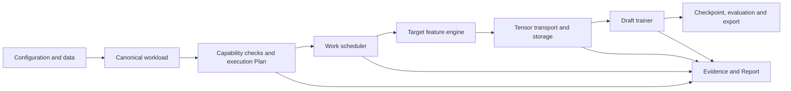

# Architecture

ASpec trains speculative decoding Draft models with an asynchronous Target-feature producer and
Draft-training consumer. Its implementation starts from retained TorchSpec code, with selected
AngelSpec adaptations. Source headers, [source references](REFERENCES.md) and the texts under
[`licenses/`](../../licenses/) identify the derivations.

The diagram describes responsibilities, not a required class hierarchy or process topology.

Target and Draft start in independent environments. A versioned JSON service interface carries
model/capture identity, token requests, output descriptors and lifecycle calls; feature tensors use
the existing Mooncake data plane. Draft's Ray reserves only training GPUs; Target exclusively
leases GPUs from its own CUDA-visible pool. The control proxies require no GPUs and do not
translate Draft GPU ordinals into Target allocations. Each side owns its runtime and native library paths.
An optional local supervisor starts this same service and retains the full checkpoint/resume path.
Lost control stops admission; source storage remains retained until reader process exit is verified.
Reachable Targets acknowledge forced cleanup only after their session's source processes exit.
Node-local fail-stop domain loss is recorded separately from observed process exit.

## Configuration, workload and Plan

The configuration boundary translates supported native or TorchSpec-style inputs into canonical
types. Training semantics describe what to train; execution policy describes resource requirements
and preferences. Legacy fields stop at that boundary.

The planner resolves available capabilities and rejects illegal combinations before starting work.
Required capabilities fail closed. Allowed fallback and omission appear explicitly in Plan/Evidence.
Requested, resolved, effective and observed values remain distinct; an unobserved fact stays unknown.
See [configuration](../user-guide/configuration.md) and [topology selection](../user-guide/topology.md).

## Scheduling and work identity

The scheduler tracks stable source-work identity across asynchronous completion, packing, regrouping
and recovery. A committed optimizer update must neither lose nor repeat work. Packing selects complete
documents and preserves boundaries, supervision and document-local positions; trainers consume the
selected grouping rather than choosing a different one.

For padded multi-document microbatches, source selection first fixes a complete
dispatch. The scheduler forms length-adjacent microbatches inside each locality
domain and assigns whole microbatches across its DP ranks, balancing cumulative
padded context work over the optimizer step. It does not reserve additional
outputs or wait for the full global batch. Scheduling loads reset at optimizer
boundaries; storage ownership and committed-work recovery use the existing ledger.

Finite sources use explicit drop-last. Fixed rows align to complete optimizer batches in Plan.
Packed document counts become known at runtime: Plan records a DP-aligned scheduled upper bound and
Evidence records effective work and the final incomplete-step drop. Work is never duplicated or
replayed merely to fill a tail. See [packing and CP](../user-guide/structures.md#packing-and-context-parallelism).

Ready-output credits, in-flight engine requests and dispatched-but-owned outputs are separate.
Stopping admission does not abandon already accepted work. Finite overshoot remains observable.

## Feature contracts and ownership

The producer and consumer validate Target binding, ordered capture layers, normalization, dtype,
layout and actual tensor metadata. Shared capture may take the union of compatible layer requests;
each Draft has an independent consumer-view identity. Incompatible dtype, normalization or Target
bindings cannot be silently shared.

Every output/storage lease has one current owner and observable production, dispatch, release and
terminal states. Success, failure and cancellation must fence readers before reclaiming their data.
Device model memory, backend token capacity, transfer/storage buffers and host/orchestrator memory
are planned and reported separately.

## Draft training and assets

Algorithm identity determines objectives, feature interpretation and rollout; model structure
determines attention, FFN and heads. Backend, packing, parallelism and transport determine execution.
These identities are not interchangeable. [Supported paths](../support.md) describe their boundaries.

Each shared Draft owns weights, optimizer, schedule, RNG, committed work, evaluation and checkpoints.
There is no shared optimizer-step barrier. Slow readers apply bounded backpressure; safely fenced
failed readers need not stop healthy siblings. Shared multi-node training is outside the current path.

Exact resume restores all required training state and identities. Weights-only initialization starts
a new phase. Export preserves actual algorithm/structure/stage, vocabulary mapping, frozen Target
bindings and tensor dtype; strict loading rejects incomplete assets. Export format compatibility
does not certify a downstream serving runtime. See [recovery](../user-guide/training.md) and
[evaluation/export](../user-guide/evaluation.md).

## Static multi-node execution

Storage is explicit: the formal multi-node recipe uses independent local filesystems, verified input replicas, bounded checkpoint collection and explicit resume distribution. Shared storage remains optional.

Plans express nodes, GPU placement, parallel groups, interconnects and failure domains rather than
one aggregate GPU count. Model-parallel groups remain node-local. An attempt uses static homogeneous
members; failures fence the old attempt before recovery from a complete checkpoint.

Host-staged TCP, registered-CUDA TCP and RDMA/GPU Direct are distinct capabilities, without silent
fallback between them. TCP does not imply network GPUDirect. Node-local affinity requires local
Target/Draft placement and strict NVLink for features; Draft gradient collectives may cross nodes.
Scheduling uses verified actor placement and per-locality ready credits, never handle order or
cross-node feature stealing. See [multi-node setup](../user-guide/multinode.md).

## Evidence and claims

Evidence binds inputs, versions, effective execution, fallback/omission, committed work, measurements
and shutdown. Throughput requires a continuous optimizer-step window with positive committed work;
finite loss/gradient norms and lifecycle health are separate predicates. An end-to-end producer rate
is coupled to backpressure and cannot stand in for isolated service capacity.

Configured backend token capacity and observed long-context execution are also
separate claims. Evidence records the exact configured limit and observed
coverage; a natural workload can establish long-context execution without a
document padded or repeated to the configured 256K ceiling.

Functional smoke, numerical comparison, long-run reliability, held-out quality and decode equality
are separate acceptance scopes. [Benchmark methodology](../benchmarks/methodology.md) defines
performance comparisons. [Known limitations](../support.md#known-limitations) remain visible even
when a smaller functional smoke succeeds.
